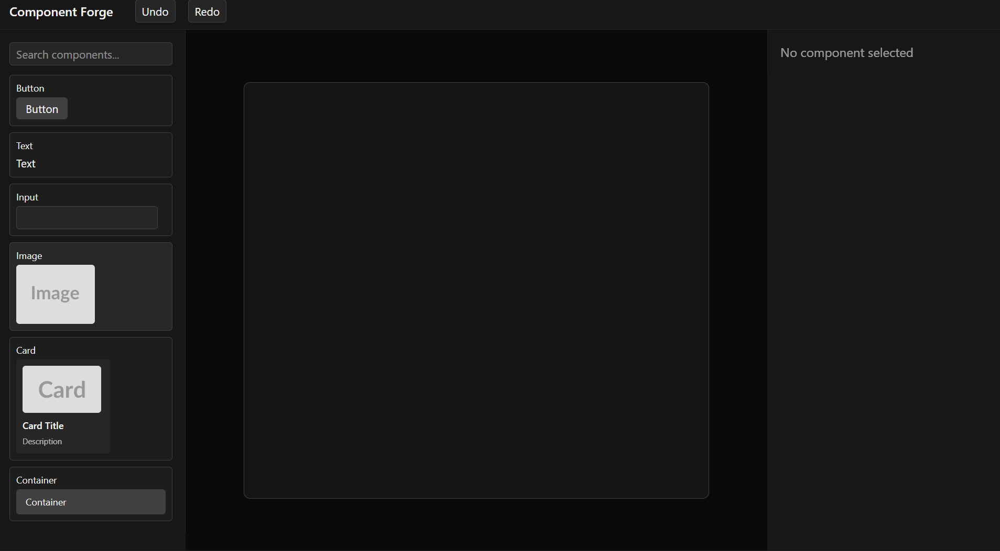
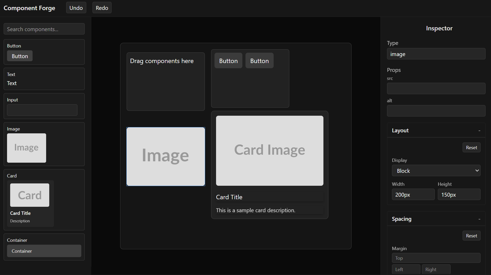

## Component-Forge

    Component‑Forge is a developer playground for building and testing reusable UI components with drag‑and‑drop interactions, live preview, and scalable architecture.

---

## Features

    - Play around with a drag-and-drop canvas
    - Style components interactively using the Inspector section
    - Track and render components via a dynamic tree structure
    - See instant updates with live preview

---

## Tech Stack

    - React + vite for it's fast setup
    - TailwindCSS v4 for styling with responsive design
    - Zustand for lightweight state management

---

## Live Demo

https://halfian.github.io/component-forge/

---

## Setup Instruction

1. Clone the repo
   - git clone https://github.com/Halfian/component-forge.git
   - cd component-forge
2. Install Dependencies
   - npm install
3. Run In Development
   - npm run dev

---

## Screenshot

---

## Deployment Notes

Hosted on GitHub Pages with Vite build pipeline.

---

## Future Improvement

    - Export components as reusable code snippets

    - Save/load projects from local storage

    - Add collaborative editing mode
